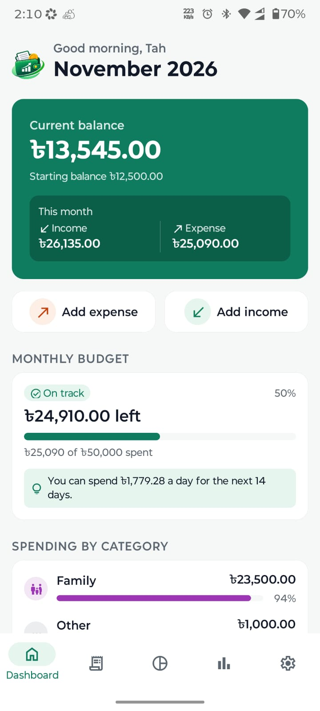
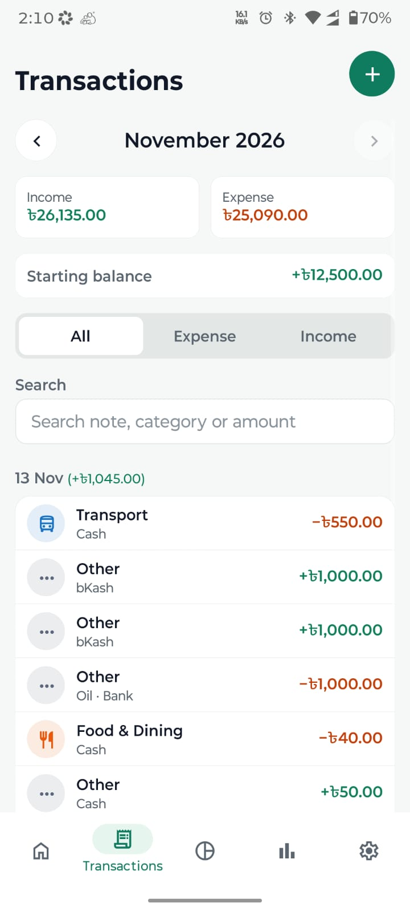
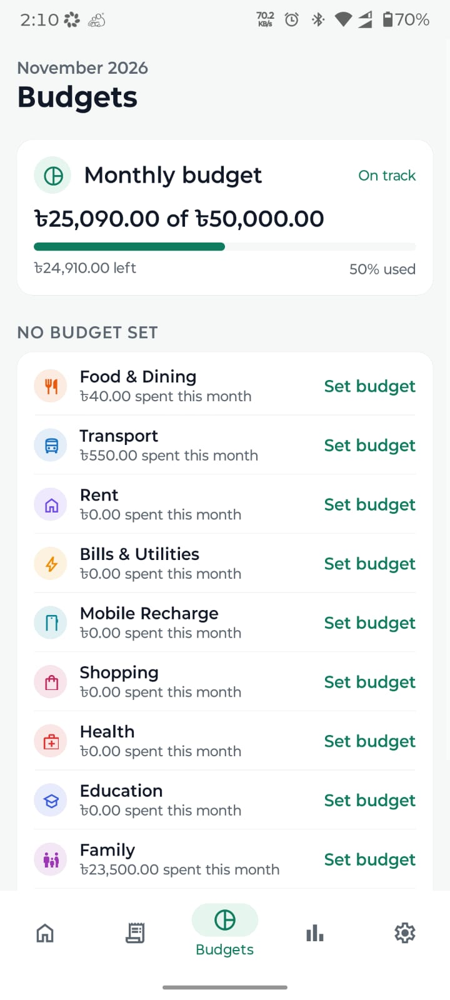
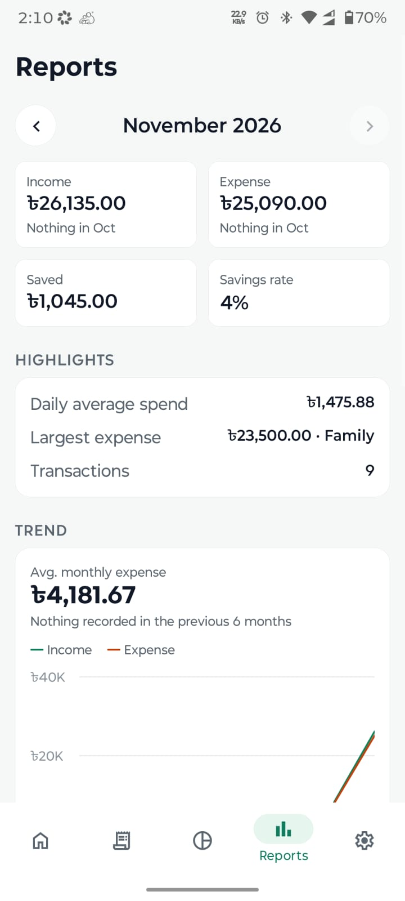
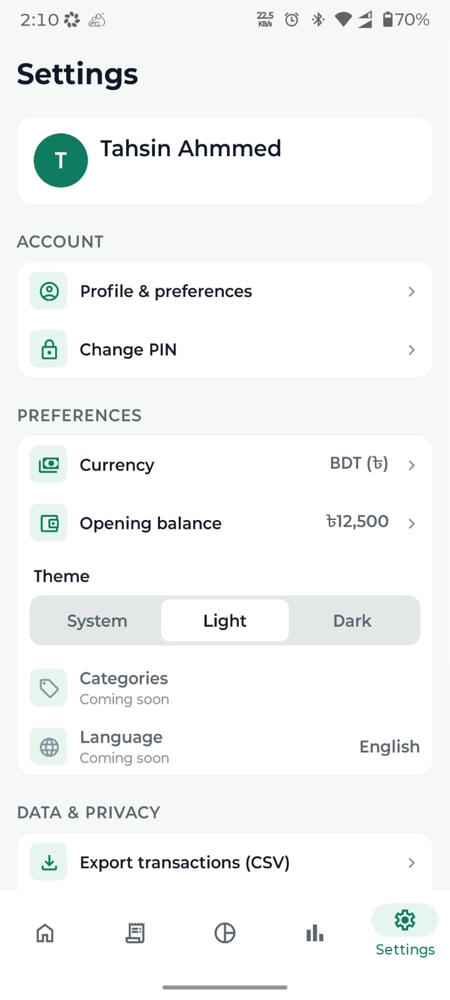
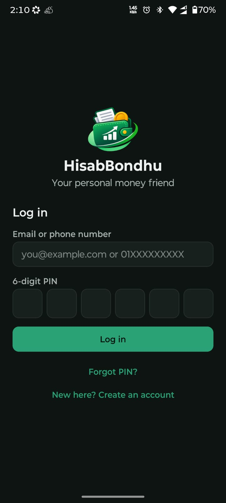

<p align="center">
  
</p>

<h1 align="center">HisabBondhu</h1>

<p align="center">
  <strong>A personal expense and budget tracker built for people in Bangladesh.</strong><br />
  Android app · React Native, Expo and TypeScript · Supabase (PostgreSQL) backend
</p>

---

HisabBondhu ("your accounts friend") helps you record daily income and expenses, keep to
monthly budgets and see where your money goes. It speaks Taka natively (৳1,00,000 with
lakh/crore grouping), understands bKash and Nagad as payment methods, and keeps each
person's financial data private at the database level.

## Screenshots

<p align="center">
  
  
  
</p>
<p align="center">
  
  
  
</p>

<p align="center">
  <sub>Dashboard · Transactions · Budgets · Reports · Settings · Log in (dark mode)</sub>
</p>

## Features

- **Sign in with email or a Bangladeshi mobile number** and a 6-digit PIN; easy PINs
  (`123456`, `111111`, …) are rejected. Forgot-PIN by email, change PIN, log out and
  in-app account deletion.
- **Income and expenses** with categories, payment method (Cash, bKash, Nagad, Bank, Card),
  date and note. Edit or delete any entry.
- **Dashboard**: current balance, how the month started (balance carried over from the
  previous month), this month's income and expense, budget status with a safe amount to
  spend per day, top spending categories and recent transactions.
- **Transaction history** month by month, grouped by day with daily totals, filters and
  search (by note, category, payment method or amount).
- **Monthly budgets**: one overall limit plus per-category limits, with "on track",
  "almost used" and "over budget" states. Budget changes apply from the current month on,
  so past months keep their real limits.
- **Reports**: income, expense, savings rate and change versus last month; an interactive
  income-vs-expense line chart (1M / 3M / 6M / 1Y) with touch tooltip and table view;
  spending by category and by payment method; budget results per month.
- **Preferences**: currency (BDT, INR, USD, EUR, GBP), opening balance, first day of the
  week, and **light / dark / system** theme.
- **Export** all transactions to CSV through the Android share sheet.
- **Over-the-air updates**: code fixes reach the installed app without reinstalling.

## Tech stack

| Area | Technology |
|---|---|
| Mobile app | React Native 0.88, Expo SDK 58, Expo Router, TypeScript (strict) |
| State and forms | Zustand, React Hook Form, Zod |
| Charts | react-native-svg (line chart), plain views (bars) |
| Backend | Supabase: PostgreSQL, Auth, Row Level Security |
| Testing | Jest, React Native Testing Library, Expo Router testing library, SQL checks against the live database |
| Delivery | EAS Build (Android APK / app bundle), EAS Update (over-the-air updates) |

## Engineering highlights

- **Money is never a floating-point number.** Every amount is stored and calculated as an
  integer number of poisha (hundredths), so `0.1 + 0.2` problems cannot happen. Typed
  input such as `1,250.50`, `৳ 1,00,000` or Bangla digits `১২৫০` is parsed digit by digit.
- **Privacy enforced by the database.** Row Level Security policies allow each signed-in
  user to read and change only their own rows; signed-out requests get nothing. The
  database also validates every amount, category, payment method and date (no future
  transactions in Dhaka time). [`supabase/tests/rls_check.sql`](supabase/tests/rls_check.sql)
  runs 26 checks against the live database inside a transaction that is rolled back.
- **Secure session storage.** The login session is encrypted with AES-256-GCM; the key
  lives in the Android Keystore (SecureStore). When the account changes, every user's
  data is cleared from memory and late responses from the previous account are discarded.
- **Clean architecture.** Screens are thin; business rules (money, dates, budgets,
  balance, reports) are plain TypeScript in `domain/` and fully unit-tested; features talk
  to storage only through repository interfaces, which made the move from on-device
  SQLite to Supabase a change in one layer.
- **Calendar-correct dates for Bangladesh.** Transactions store the calendar day in
  Asia/Dhaka, so monthly totals never shift across midnight.
- **Accessible, themeable UI.** Every screen supports light and dark themes from one set of
  colour tokens; chart colours were checked for colour-blind separation and contrast in
  both modes; changes are always shown with arrows and words, never colour alone.
- **Bangla-ready.** All text goes through one translation function with whole-sentence
  templates, so a Bangla translation can reorder words freely.

## Project structure

```
.
├── mobile/                  Expo app
│   └── src/
│       ├── app/             Routes (Expo Router), thin screens only
│       ├── components/ui/   Reusable UI (buttons, fields, cards, PIN field, …)
│       ├── features/        auth, dashboard, transactions, budgets, reports, settings, …
│       ├── domain/          Business rules: money, dates, budgets, balance (plain TS)
│       ├── data/            Repository interfaces + Supabase implementations
│       ├── theme/           Light/dark palettes, spacing, typography, theme hooks
│       └── i18n/            Strings and date/number formatting
└── supabase/
    ├── migrations/          Database schema, constraints and RLS policies
    └── tests/rls_check.sql  Security checks against the live database
```

## Running it locally

Requirements: Node.js 20+, an Android phone with **Expo Go**, and a Supabase project.

```bash
# 1. Database: link your Supabase project and apply the migrations
npx supabase login
npx supabase link --project-ref <your-project-ref>
npx supabase db push

# 2. App configuration
cd mobile
cp .env.example .env     # then fill in your Supabase URL and publishable key

# 3. Install and start
npm install
npx expo start           # scan the QR code with Expo Go
```

Only the Supabase **publishable** key belongs in the app. Never put the secret
(service-role) key in `.env` or `eas.json`.

### Quality checks

```bash
cd mobile
npm run check            # TypeScript, ESLint, Prettier and all Jest tests (334 tests)
```

### Building and updating the Android app

```bash
cd mobile
npx eas-cli@latest build -p android --profile preview      # installable APK
npm run update:preview -- --message "Describe the change"   # over-the-air update
```

## Roadmap

- [ ] Transactions page redesign
- [ ] Custom categories
- [ ] Bangla language
- [ ] SMS verification of phone numbers and lockout after repeated wrong PINs
- [ ] Recurring transactions
- [ ] Web admin panel (Next.js): user statistics, category management, audit log
- [ ] End-to-end tests and Google Play release

## Author

Built by **Tahsin Ahmmed** ([@Tahsin-ahmmed](https://github.com/Tahsin-ahmmed)).
